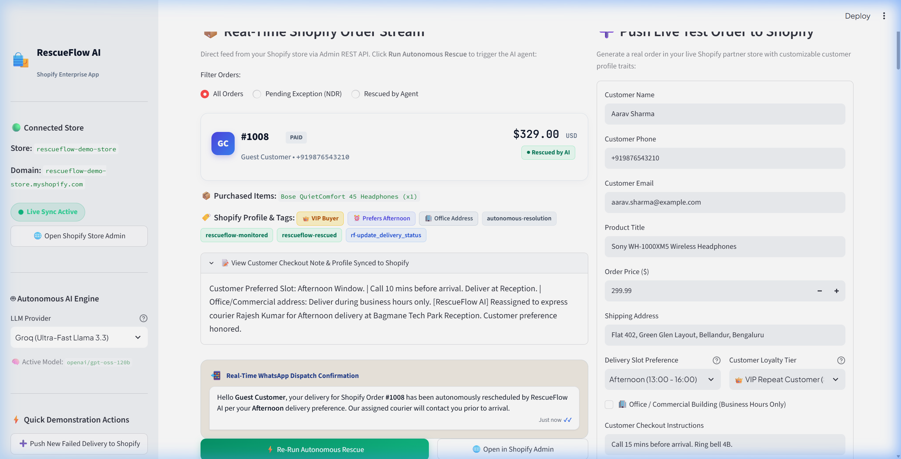
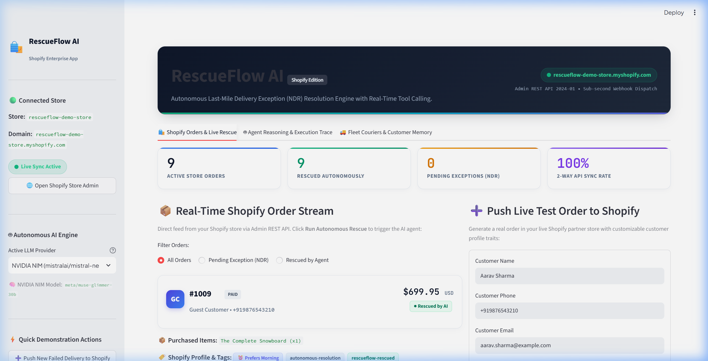
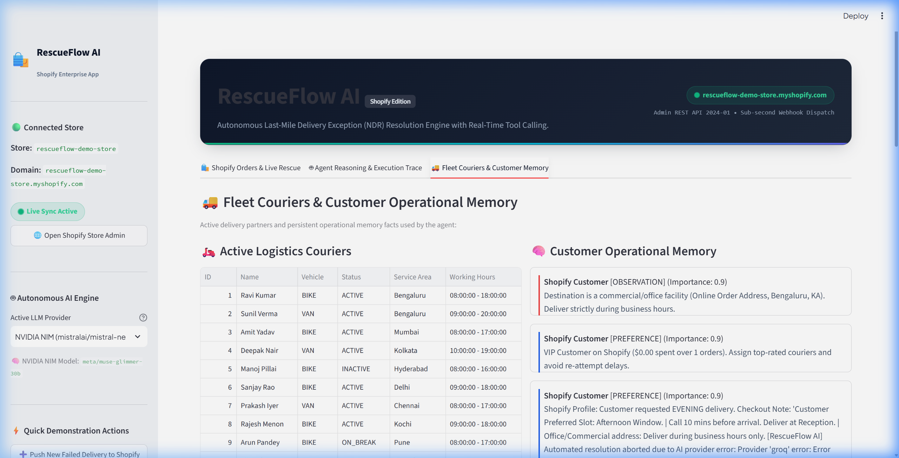
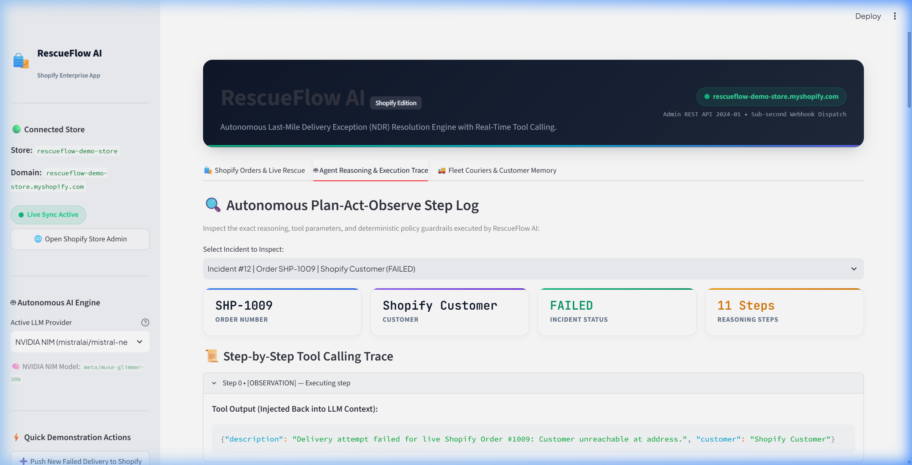
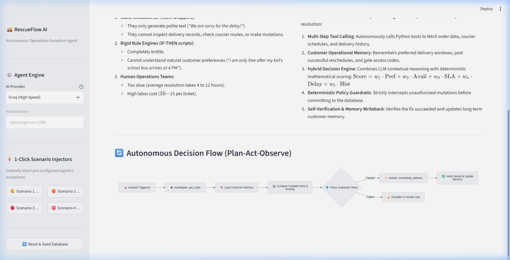

# 🚚 RescueFlow AI — Autonomous Delivery-Exception Resolution Engine for Shopify

[](https://www.python.org/)
[](LICENSE)
[](tests/)
[](https://fastapi.tiangolo.com)
[](https://streamlit.io)
[](https://shopify.dev/docs/api/admin-rest)

**RescueFlow AI** is an enterprise autonomous decision-making agent engineered to eliminate last-mile delivery failures (**Non-Delivery Reports or NDRs**) and Return-To-Origin (RTO) losses for e-commerce merchants. 

Operating on a strict **Plan-Act-Observe** agentic loop backed by deterministic policy guardrails, RescueFlow AI intercepts delivery failure events, inspects customer behavioral attributes (VIP tiers, preferred time slots, and commercial/office premises constraints) directly from the **Shopify Admin REST API**, evaluates courier fleet capacities, executes safe rescheduling mutations, and writes verified resolution metadata back to Shopify in real time.

---

## 📸 System Showcase & Visual Walkthrough

### 1. Live Shopify Operations Console & Order Rescue Pipeline
*Real-time bidirectional synchronization with Shopify Admin REST API showing active customer orders, VIP badges, time window preferences, and 1-click autonomous rescue execution.*



---

### 2. Real-Time Customer Notification & WhatsApp Dispatch
*Autonomous generation and simulated dispatch of interactive WhatsApp/SMS messages tailored strictly to the buyer's checkout preferences.*



---

### 3. Agent Reasoning & Multi-Step Execution Trace
*Inspectable Plan-Act-Observe trajectory demonstrating sequential Python tool calling (`get_order` ➔ `get_customer_profile` ➔ `find_available_delivery_slots` ➔ `reschedule_delivery`).*



---

### 4. Fleet Management & Cross-Order Customer Memory
*Real-time active courier vehicle tracking (bikes/vans), capacity metrics, and persistent operational memory capturing customer constraints (e.g. office closing hours, pre-arrival call protocols).*



---

### 5. Enterprise Decision Architecture & Guardrail Engine
*End-to-end event flow: Inbound Webhook ➔ LLM Reasoner ➔ Deterministic Guardrails ➔ Tool Execution ➔ Outbound Shopify Sync.*



---

## ✨ Key Capabilities

* 🧠 **Autonomous Plan-Act-Observe Loop:** Iteratively investigates order context, discovers viable delivery windows, and executes verified state mutations without human triage.
* 🛡️ **Deterministic Safety Guardrails:** Hard business rules enforce commercial building hours (09:00–18:00), courier vehicle load limits, and maximum retry policies before actions are committed.
* ⚡ **Multi-Provider Auto-Failover (`FallbackProvider`):** Transparently handles API rate limits (429) or outages by automatically chaining `NVIDIA NIM ➔ Groq ➔ Deterministic Offline Heuristic`.
* 🔌 **Sub-Second Webhook Engine (`FastAPI`):** Features `POST /webhooks/ndr` and `POST /webhooks/customer-reply` to process carrier events and buyer responses asynchronously via `BackgroundTasks`.
* 🛍️ **Bidirectional Shopify 2-Way Sync:** Automatically reads customer checkout notes, writes resolution tags (e.g., `rf-reschedule_delivery`, `rescueflow-rescued`), and updates merchant timeline notes.
* 💾 **Persistent Operational Memory:** Captures behavioral preferences across orders (e.g., *"Customer requires 10-min call before arrival; deliver to reception"*).

---

## 🏛️ System Architecture

```
                    ┌─────────────────────────────────────────┐
                    │     Inbound Carrier NDR / Webhook       │
                    │   (Shopify / Delhivery / Shiprocket)    │
                    └────────────────────┬────────────────────┘
                                         │  POST /webhooks/ndr
                                         ▼
                    ┌─────────────────────────────────────────┐
                    │    FastAPI Sub-second Webhook Engine    │
                    │      (app/server.py BackgroundTasks)    │
                    └────────────────────┬────────────────────┘
                                         │
                                         ▼
                    ┌─────────────────────────────────────────┐
                    │            RescueFlow Agent             │
                    │     (Plan - Act - Observe Loop)         │
                    └────────────┬────────────────────────────┘
                                 │
        ┌────────────────────────┼────────────────────────┐
        ▼                        ▼                        ▼
┌──────────────┐         ┌──────────────┐         ┌──────────────┐
│  Multi-LLM   │         │ Deterministic│         │ Python Tool  │
│  Failover    │         │  Guardrails  │         │   Registry   │
│ (NVIDIA/Groq)│         │(PolicyEngine)│         │ (8 Mutations)│
└──────────────┘         └──────────────┘         └──────┬───────┘
                                                         │
                                 ┌───────────────────────┴────────┐
                                 ▼                                ▼
                     ┌───────────────────────┐        ┌───────────────────────┐
                     │ Live Shopify Admin API│        │ Customer WhatsApp/SMS │
                     │  (Tags & Audit Notes) │        │ (Interactive Dispatch)│
                     └───────────────────────┘        └───────────────────────┘
```

---

## 🛠️ Python Tools Reference

All tools operate on real database state through SQLAlchemy:

| Tool Name | Type | Description |
|---|---|---|
| `get_order(order_id)` | Read | Retrieves order info, delivery status, and courier assignment |
| `get_customer_profile(customer_id)` | Read | Retrieves customer contact details, address, preferences, and memory |
| `get_delivery_history(order_id)` | Read | Retrieves all previous delivery attempts, timestamps, and failure reasons |
| `get_courier_availability(area, date)` | Read | Checks active couriers and working hours in a delivery zone |
| `find_available_delivery_slots(customer_id, date)` | Read | Discovers and deterministically scores feasible delivery windows |
| `reschedule_delivery(order_id, date, start_time, end_time)` | Mutation | Safely updates scheduled delivery date and time slot |
| `reassign_courier(order_id, courier_id)` | Mutation | Reassigns delivery to another verified active courier |
| `update_delivery_status(order_id, status)` | Mutation | Updates lifecycle status (e.g. IN_TRANSIT, DELIVERED, ESCALATED) |
| `escalate_incident(order_id, reason)` | Mutation | Escalates to human supervisor when recovery options are infeasible |

---

## 🚀 Quickstart & Installation

### 1. Clone & Set Up Environment
```bash
git clone https://github.com/SKrock-1/RescueFlow-AI.git
cd RescueFlow-AI

python -m venv .venv
# Windows:
.venv\Scripts\activate
# Linux/macOS:
source .venv/bin/activate

pip install -r requirements.txt
```

### 2. Configure Environment (`.env`)
Copy `.env.example` to `.env` and configure your credentials:
```env
# ── LLM Provider (auto | nvidia | groq | mock) ──
LLM_PROVIDER=auto

# ── Groq Configuration ──
GROQ_API_KEY=gsk_your_groq_key
GROQ_MODEL=openai/gpt-oss-20b

# ── NVIDIA NIM Configuration ──
NVIDIA_API_KEY=nvapi-your_nvidia_key
NVIDIA_BASE_URL=https://integrate.api.nvidia.com/v1
NVIDIA_MODEL=meta/muse-glimmer-30b

# ── Shopify Admin REST API ──
SHOPIFY_STORE_URL=your-store.myshopify.com
SHOPIFY_ACCESS_TOKEN=shpat_your_shopify_access_token
```

### 3. Initialize & Seed Database
```bash
python -c "from app.database.engine import init_db; from app.database.seed import seed_all; init_db(); seed_all()"
```

### 4. Run the Streamlit Dashboard
```bash
streamlit run ui/streamlit_app.py
```
Open **[http://localhost:8501](http://localhost:8501)** in your browser.

### 5. Run the Autonomous Webhook Engine
```bash
python -m app.server
# Or: uvicorn app.server:app --port 8000 --reload
```
Interactive API documentation live at **[http://localhost:8000/docs](http://localhost:8000/docs)**.

---

## 📡 Webhook API Specification

### Ingest Delivery Failure (NDR)
```http
POST /webhooks/ndr HTTP/1.1
Content-Type: application/json

{
  "event": "delivery_failed",
  "order_id": "7044622647598",
  "order_name": "#1007",
  "failure_reason": "Customer unreachable at reception",
  "carrier": "Delhivery"
}
```
**Response (202 Accepted):**
```json
{
  "status": "accepted",
  "message": "Autonomous rescue pipeline scheduled for order #1007",
  "event": "delivery_failed",
  "mode": "autonomous_async"
}
```

### Ingest Inbound Customer Reply
```http
POST /webhooks/customer-reply HTTP/1.1
Content-Type: application/json

{
  "order_number": "#1007",
  "customer_phone": "+919876543210",
  "message": "Please deliver tomorrow afternoon between 3pm and 5pm"
}
```

---

## 🧪 Test Suite

Run the complete test suite covering tool mutations, guardrails, scoring, failover, and webhooks:

```bash
python -m pytest tests/
```

```text
============================= test session starts =============================
platform win32 -- Python 3.14.6, pytest-8.4.2
collected 44 items

tests/test_cli.py ..                                                     [  4%]
tests/test_fallback.py ..                                                [  9%]
tests/test_guardrails.py ..                                              [ 13%]
tests/test_integration.py .....                                          [ 25%]
tests/test_memory.py ...                                                 [ 31%]
tests/test_policy.py ........                                            [ 50%]
tests/test_scoring.py .....                                              [ 61%]
tests/test_server.py ...                                                 [ 68%]
tests/test_tools.py ..............                                       [100%]

============================= 44 passed in 2.29s ==============================
```

---

## 📄 License
This project is licensed under the MIT License — see the [LICENSE](LICENSE) file for details.
